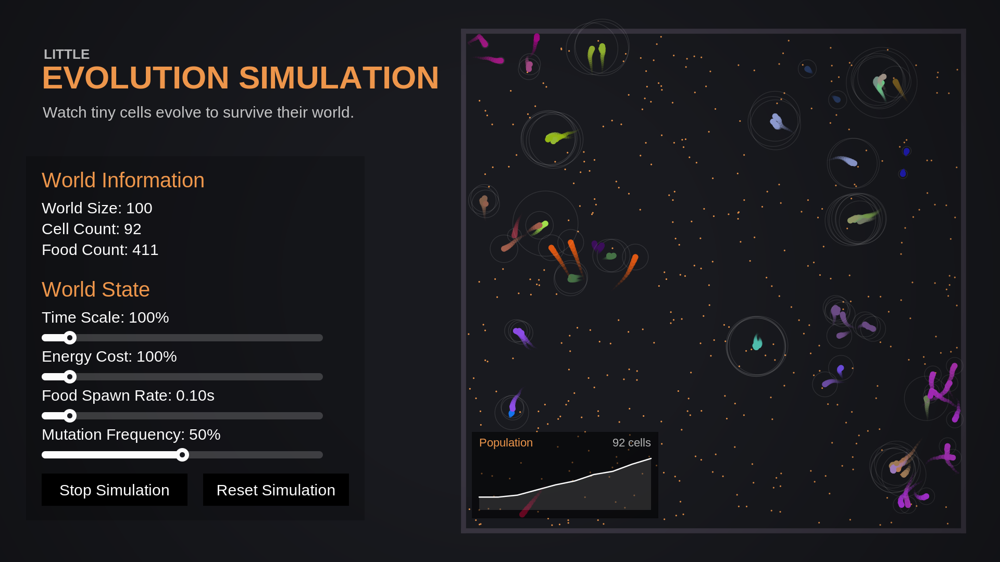
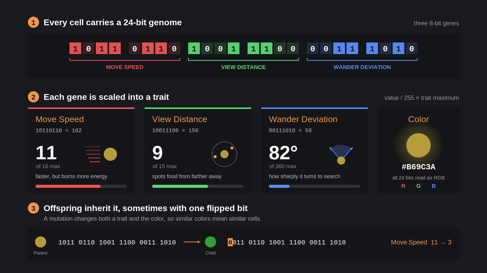

<h1 align="center">Evolution Simulation</h1>
<h3 align="center">You can run the simulation here: https://tavyz.itch.io/evolution-simulator</h3>
Simulate and optimize the genetic makeup of small cells to thrive in changing world conditions. Experiment with traits and watch as cells adapt to their environment.

## How to download for yourself
Clone the repository and open with Unity 😄
